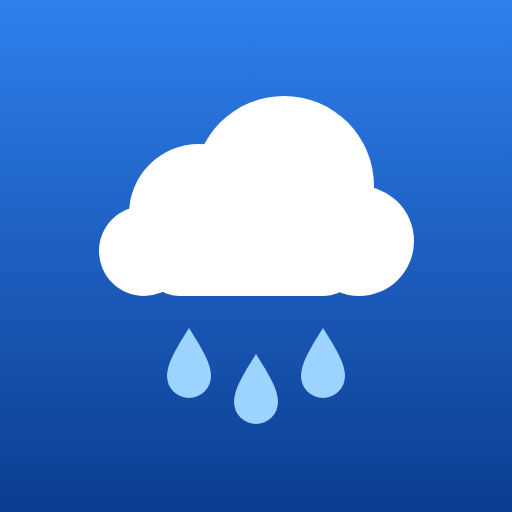

# ☔ Awas Hujan

**Awas Hujan** (Malay for *"rain alert"*) is a lightweight rain map in the spirit of [rain-alarm.com](https://www.rain-alarm.com/). It shows live rain radar on an OpenStreetMap map and tells you whether rain is coming to your location or your saved places.

It is a single static web page: no backend, no build step, no API keys and no account.

<p align="center">
  
</p>

## Features

- **Live rain radar animation**: the last ~2 hours of radar in 10-minute frames, with play/pause, a time slider and an opacity control. It reloads new frames every 5 minutes.
- **Rain forecast for any spot**: click anywhere on the map or tap **📍 My location** to see:
  - a banner saying "Rain now", "Rain expected around HH:MM" or "No rain in the next 2 hours"
  - a bar chart of the next 2 hours in 15-minute steps (mm/h)
  - the chance and amount of rain for each of the next 12 hours
- **Rain alerts**: optional browser notifications when rain is expected at the selected spot. The forecast refreshes every 10 minutes while the page is open.
- **Saved places**: save spots as *Home*, *Work*, *School* or any name. They appear as labelled markers on the map and in the **★ Places** menu.
- **Remembers your map**: the page reopens at the zoom and position you last used.
- **Installable**: add it to your iPhone or Android home screen and it opens full-screen with its own icon.
- Works on desktop and mobile, in light and dark mode.

## Data sources

Your browser fetches all data directly from these free, public services:

| What | Source | Notes |
| --- | --- | --- |
| Rain radar tiles | [RainViewer API](https://www.rainviewer.com/api.html) | Past ~2 hours only. Free tier is sharp up to zoom level 7; closer zoom levels are upscaled. |
| Point forecast | [Open-Meteo](https://open-meteo.com/) | 15-minute and hourly precipitation from weather models (ECMWF, GFS, ICON, …). Free for non-commercial use. |
| Base map | [OpenStreetMap](https://www.openstreetmap.org/copyright), Humanitarian style tiles by [OSM France](https://openstreetmap.fr/) | |
| Your location | Browser Geolocation API | Used only to centre the map and request the forecast. |

The radar shows rain that **has already fallen**. The rain alert comes from Open-Meteo's **forecast**, not from radar.

## Running locally

Any static file server works. For example, from the project folder:

```bash
python -m http.server 5500
```

Or with Node.js:

```bash
npx serve -l 5500
```

Then open <http://localhost:5500>.

Opening `index.html` straight from disk (`file://`) is not recommended, because location and notifications need `localhost` or HTTPS.

## Deploying (GitHub Pages)

1. In the repository, go to **Settings → Pages**.
2. Under **Build and deployment**, choose **Deploy from a branch**, select `main` and `/ (root)`, then save.
3. After a minute the site is live at `https://<your-username>.github.io/awas-hujan/`.

The site must be served over HTTPS for **My location** and installing to the home screen to work. GitHub Pages provides HTTPS.

## Add to your phone's home screen

**iPhone (Safari)**: open the site, tap **Share** → **Add to Home Screen**.

**Android (Chrome)**: open the site, tap **⋮** → **Add to Home screen** / **Install app**.

> **Note (iPhone):** the home-screen app keeps its own storage, separate from Safari. Places you saved in Safari won't appear there, so save *Home* / *Work* again inside the installed app.
>
> If you added the page to your home screen before the icon existed, remove it and add it again; iOS doesn't refresh existing icons.

## Where your data is stored

Saved places and the last map view are kept in your browser's **localStorage** (keys `awasHujan.places` and `awasHujan.view`).

- Nothing is sent to any server of ours, because there is none.
- Saved places stay on that browser and device only. They don't sync between your phone and computer.
- Clearing the browser's site data removes them.

## Project structure

```
index.html            The whole app: HTML, CSS and JavaScript (uses Leaflet from cdnjs)
manifest.webmanifest  Web app manifest (name, colours, icons) for installing
icons/
  icon.svg            Master icon, also used as the favicon
  apple-touch-icon.png  180×180 icon for iPhone home screen
  icon-192.png        Android / manifest icons
  icon-512.png
.claude/launch.json   Local dev server config
```

## Limitations

- Radar has no future (nowcast) frames on RainViewer's free tier, and the radar becomes blocky past zoom level 7.
- Rain alerts only work while the page or app is open; there is no background push service.
- RainViewer and Open-Meteo free tiers are meant for personal and low-traffic use. Check their terms before running a busy public site.

## Credits

- Radar: © [RainViewer](https://www.rainviewer.com/)
- Forecast: [Open-Meteo](https://open-meteo.com/) (CC BY 4.0)
- Map data: © [OpenStreetMap](https://www.openstreetmap.org/copyright) contributors; tiles by [HOT](https://www.hotosm.org/) / [OSM France](https://openstreetmap.fr/)
- Map library: [Leaflet](https://leafletjs.com/)
